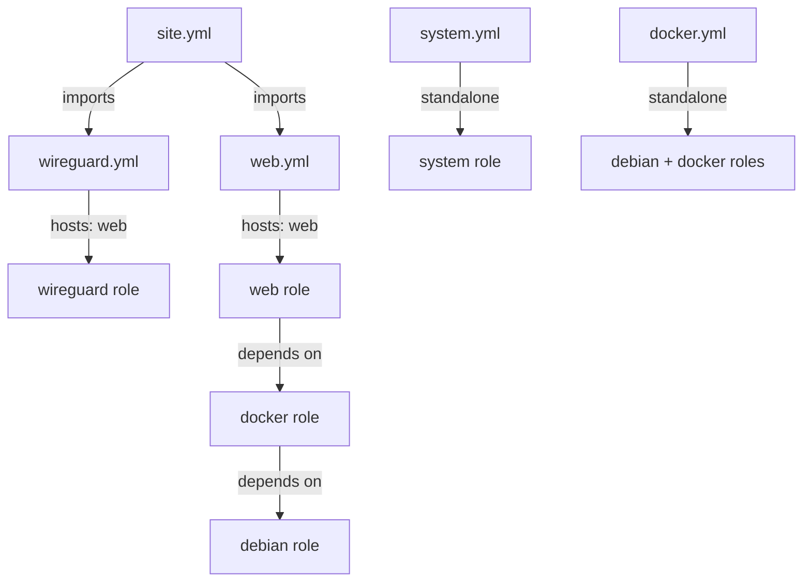
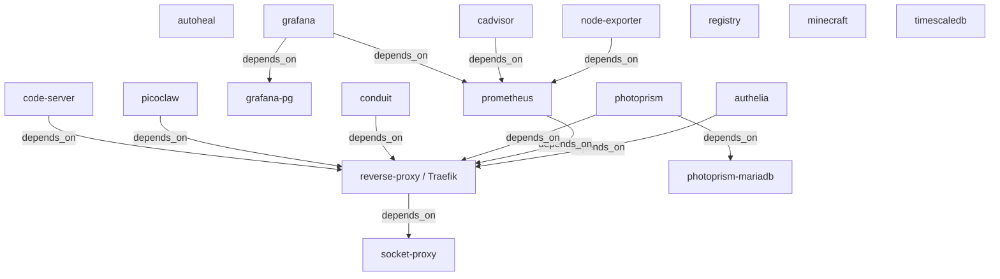
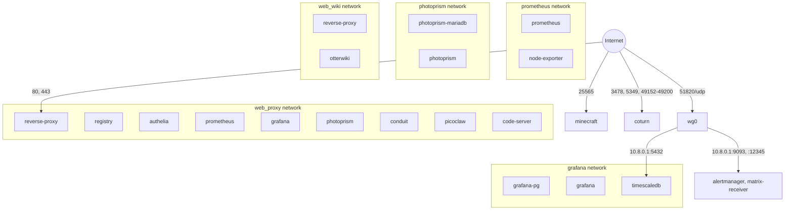
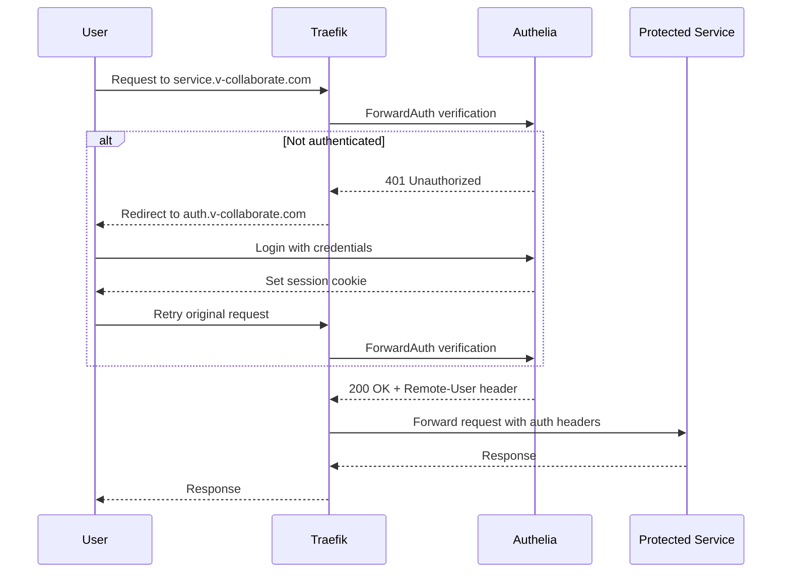
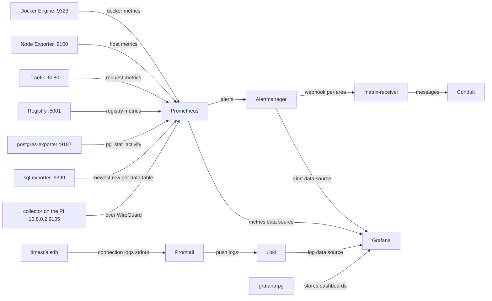

# Architecture

This document describes the architecture of the Ansible-based Docker server provisioning project. The project automates the setup of a Debian server, installs Docker, and deploys 18 containerized services via docker-compose.

## Table of Contents

- [Overview](#overview)
- [Ansible Structure](#ansible-structure)
- [Server Provisioning](#server-provisioning)
- [Docker Services](#docker-services)
- [Network Architecture](#network-architecture)
- [Reverse Proxy and Authentication](#reverse-proxy-and-authentication)
- [Monitoring Stack](#monitoring-stack)
- [Data Persistence](#data-persistence)
- [Backup and Maintenance](#backup-and-maintenance)
- [Security](#security)
- [Hosting Requirements and Migration](#hosting-requirements-and-migration)

---

## Overview

This project provisions a dedicated Debian server hosted at IONOS and deploys a full-stack application environment using Docker containers. The infrastructure is managed entirely through Ansible playbooks, with sensitive data protected by Ansible Vault.

The server runs 21 Docker containers providing:

- **Reverse proxy and TLS termination** via Traefik with automatic Let's Encrypt certificates
- **Authentication and SSO** via Authelia
- **Monitoring and dashboarding** via Prometheus, Node Exporter, and Grafana
- **Database services** including PostgreSQL, TimescaleDB, and MariaDB
- **Application services** including a private Docker registry, PhotoPrism photo management, and a Minecraft game server

All web-facing services are accessible through subdomains of `v-collaborate.com`, routed through Traefik with HTTPS enforcement.

---

## Ansible Structure

### Playbook Hierarchy



| Playbook | Target Group | Purpose |
|---|---|---|
| [`site.yml`](site.yml) | — | Main entry point; imports [`hardening.yml`](hardening.yml), [`wireguard.yml`](wireguard.yml) and [`web.yml`](web.yml) |
| [`wireguard.yml`](wireguard.yml) | `web` | WireGuard interface `wg0` (`10.8.0.1`, UDP 51820) for the Pi's tunnel to TimescaleDB; peers in [`group_vars/web/vars.yml`](group_vars/web/vars.yml) |
| [`system.yml`](system.yml) | `system` | Initial server setup as root — creates `devops` user, hardens SSH |
| [`docker.yml`](docker.yml) | `web` | Standalone playbook to install Docker CE with the `debian` and `docker` roles |
| [`web.yml`](web.yml) | `web` | Deploys all Docker containers via the `web` role |

### Role Dependency Chain


The [`web`](roles/web/meta/main.yml) role declares a dependency on [`docker`](roles/docker/meta/main.yml), which in turn depends on [`debian`](roles/debian/tasks/main.yml). Running `web.yml` automatically executes all three roles in order.

### Partial Deploys

A run without `--tags` deploys everything. Tagged task files can also be deployed on their own:

| Tag | Task file | Deploys |
|---|---|---|
| `grafana_dashboards` | [`grafana_dashboards.yml`](roles/web/tasks/grafana_dashboards.yml) | Everything in [`files/grafana/provisioning/dashboards/`](roles/web/files/grafana/provisioning/dashboards/), including subdirectories, the dashboard provider and the alert rules in [`files/grafana/provisioning/alerting/`](roles/web/files/grafana/provisioning/alerting/). Restarts Grafana only when the provider, the go-e datasource or an alert rule changed. |

```bash
ansible-playbook web.yml --tags grafana_dashboards
```

A tagged file has to be pulled in with `import_tasks` from [`main.yml`](roles/web/tasks/main.yml). The per-container loop there uses a dynamic `include_tasks`, which does not pass a tag to the tasks it includes. Tasks without the tag are skipped, including those of the `debian`, `docker` and hardening plays.

### Inventory

Defined in [`hosts.yml`](hosts.yml), the inventory targets a single dedicated server with two logical host groups:

| Group | Host | User | Purpose |
|---|---|---|---|
| `system` | `sys1` | `root` | Initial system provisioning |
| `web` | `web1` | `devops` | Docker and service deployment |

Both groups point to the same physical server (``<server-hostname>``).

### Configuration

[`ansible.cfg`](ansible.cfg) configures:

- **Inventory**: [`hosts.yml`](hosts.yml)
- **Vault**: `ask_vault_pass = False` — vault password is provided externally via `--ask-vault-pass` at runtime
- **SSH pipelining**: Enabled for performance
- **Host key checking**: Disabled for automation

### Variables

| File | Scope | Contents |
|---|---|---|
| [`group_vars/all.yml`](group_vars/all.yml) | All hosts | SSH connection, `devops` user, `topleveldomain` |
| [`group_vars/system/vars.yml`](group_vars/system/vars.yml) | `system` group | Root SSH credentials, SSH hardening flag |
| [`group_vars/system/vault.yml`](group_vars/system/vault.yml) | `system` group | Encrypted root password |
| [`group_vars/web/vault.yml`](group_vars/web/vault.yml) | `web` group | Encrypted service credentials |
| [`roles/debian/vars/main.yml`](roles/debian/vars/main.yml) | `debian` role | Debian codename |
| [`roles/docker/vars/main.yml`](roles/docker/vars/main.yml) | `docker` role | Docker directory paths |
| [`roles/web/vars/main.yml`](roles/web/vars/main.yml) | `web` role | Container list, service domains, ports |

---

## Server Provisioning

### Debian Role

The [`debian`](roles/debian/tasks/main.yml) role performs base system configuration:

1. **System updates** — Updates apt cache, installs `aptitude`, performs dist-upgrade
2. **Shell configuration** — Deploys custom [`.bashrc`](roles/debian/templates/bashrc.j2) and [`.bash_aliases`](roles/debian/templates/bash_aliases.j2) with helpful aliases and a `listening()` function for port inspection
3. **Tool installation** — Installs `bash-completion` and `colorized-logs`
4. **Python setup** — Installs Python 3 with pip and setuptools, sets Python 3 as the default via `update-alternatives`
5. **Cleanup** — Removes unused packages via `autoremove`
6. **Backup directory** — Creates `/backup` owned by the `devops` user

### Docker Role

The [`docker`](roles/docker/tasks/main.yml) role installs and configures Docker CE:

1. **User setup** — Creates the `docker` group and adds the `devops` user to it
2. **Docker environment** — Deploys [`.bash_profile_docker`](roles/docker/templates/bash_profile_docker.j2) setting `DOCKER_CLIENT_TIMEOUT=120` and `COMPOSE_HTTP_TIMEOUT=120`
3. **Package installation** — Removes legacy Docker packages, adds Docker's official GPG key and APT repository, installs `docker-ce`, `docker-ce-cli`, `containerd.io`, `docker-buildx-plugin`, and `docker-compose-plugin`
4. **Python libraries** — Installs `docker` and `docker-compose` pip packages for Ansible module support
5. **Directory structure** — Creates the Docker base directory tree under `/var/docker/`:

```
/var/docker/
├── images/
├── logs/
├── configs/
├── data/
└── work/
```

6. **Daemon configuration** — Deploys [`daemon.json`](roles/docker/templates/daemon_json.j2) enabling Docker metrics on the Docker bridge IP at port 9323 with experimental features enabled
7. **Service management** — Starts Docker, restarts if daemon config changed

### System Role

The [`system`](roles/system/tasks/main.yml) role performs initial server hardening as root:

1. **User creation** — Creates the `devops` user with a hashed password from Ansible Vault
2. **Sudo access** — Grants `devops` passwordless sudo via `/etc/sudoers.d/devops`
3. **SSH key deployment** — Deploys the operator's public SSH key for key-based authentication
4. **Locale configuration** — Sets `en_US.UTF-8`
5. **SSH hardening** — When [`disable_ssh_passwordauthentication`](group_vars/system/vars.yml) is `true`:
   - Disables password authentication
   - Disables root login
   - Restarts the SSH daemon via the [`restart ssh`](roles/system/handlers/main.yml) handler

---

## Docker Services

All 25 services are defined in the [`docker-compose_yml.j2`](roles/web/templates/docker-compose_yml.j2) template and deployed to `/var/docker/docker-compose.yml`.

| # | Service | Image | Purpose | Exposed Ports | Networks | Domain |
|---|---|---|---|---|---|---|
| 1 | `registry` | `registry:3.0.0` | Private Docker registry | — | `proxy` | `registry.v-collaborate.com` |
| 2 | `autoheal` | `willfarrell/autoheal:latest` | Automatic container restart on failure | — | — | — |
| 3 | `socket-proxy` | `tecnativa/docker-socket-proxy:v0.4.2` | Secure Docker socket proxy | — | `socket_proxy` | — |
| 4 | `reverse-proxy` | `traefik:v3.6.13` | Reverse proxy with Let's Encrypt | `80`, `443` | `proxy` | `proxy.v-collaborate.com` |
| 5 | `prometheus` | `prom/prometheus:v3.11.1` | Metrics collection | — | `proxy`, `prometheus` | `metrics.v-collaborate.com` |
| 6 | `node-exporter` | `prom/node-exporter:v1.11.1` | Host metrics exporter | — | `prometheus` | — |
| 7 | `cadvisor` | `gcr.io/cadvisor/cadvisor:v0.55.1` | Container resource metrics | — | `proxy`, `prometheus` | `cadvisor.v-collaborate.com` |
| 8 | `authelia` | `authelia/authelia:4.39.28` | Authentication / SSO | — | `proxy` | `auth.v-collaborate.com` |
| 9 | `grafana-pg` | `postgres:18-alpine` | Grafana PostgreSQL database | — | `grafana` | — |
| 10 | `grafana` | `grafana/grafana:13.2.4` | Dashboarding and visualization | — | `proxy`, `grafana` | `graph.v-collaborate.com` |
| 11 | `minecraft` | `itzg/minecraft-server:2026.4.1` | Minecraft game server | `25565` | — | — |
| 12 | `timescaledb` | `timescale/timescaledb-ha:pg16` | Time-series database | `10.8.0.1:5432` (WireGuard only) | `grafana` | — |
| 13 | `loki` | `grafana/loki:3.5.0` | Log aggregation and storage | — | `grafana` | — |
| 14 | `promtail` | `grafana/promtail:3.5.0` | Log shipper — tails TimescaleDB container logs via socket-proxy | — | `grafana`, `socket_proxy` | — |
| 15 | `postgres-exporter` | `prometheuscommunity/postgres-exporter:v0.19.1` | Exposes `pg_stat_activity` as Prometheus metrics | — | `grafana`, `prometheus` | — |
| 16 | `photoprism-mariadb` | `mariadb:10.11.16` | PhotoPrism MariaDB database | — | `photoprism` | — |
| 17 | `photoprism` | `photoprism/photoprism:260305` | AI-powered photo management | — | `proxy`, `photoprism` | `photos.v-collaborate.com` |
| 18 | `conduit` | `matrixconduit/matrix-conduit:v0.10.12` | Matrix homeserver | — | `proxy` | `matrix.v-collaborate.com` |
| 19 | `picoclaw` | `sipeed/picoclaw:v0.2.8-launcher` | AI assistant | — | `proxy` | `picoclaw.v-collaborate.com` |
| 20 | `code-server` | `lscr.io/linuxserver/code-server:latest` | Browser-based VS Code IDE | — | `proxy` | `code.v-collaborate.com` |
| 21 | `coturn` | `coturn/coturn:4.6` | STUN/TURN server for Hulls & Hellfire multiplayer | `3478`, `5349`, `49152-49200/udp` | host | `turn.v-collaborate.com` (TLS cert only) |
| 22 | `otterwiki` | `redimp/otterwiki:2.25.2` | Collaborative wiki, pages stored in git | — | `wiki` | `wiki.v-collaborate.com` |
| 23 | `alertmanager` | `prom/alertmanager:v0.34.1` | Groups, routes and silences the Prometheus alerts | `10.8.0.1:9093` (WireGuard only) | `proxy`, `prometheus` | `alerts.v-collaborate.com` |
| 24 | `matrix-receiver` | `metio/matrix-alertmanager-receiver:2026.9.23` | Posts the alerts to the Matrix rooms on Conduit | `10.8.0.1:12345` (WireGuard only) | `proxy`, `prometheus` | — |
| 25 | `sql-exporter` | `burningalchemist/sql_exporter:0.24.11` | Age of the newest row of the `data_*` tables as metrics | — | `grafana`, `prometheus` | — |

### Service Dependencies



---

## Network Architecture

Four Docker networks isolate service communication:



| Network | Name | Purpose | Connected Services |
|---|---|---|---|
| `proxy` | `web_proxy` | Traefik reverse proxy communication | registry, reverse-proxy, prometheus, authelia, grafana, photoprism, conduit, picoclaw, code-server, alertmanager, matrix-receiver (reaches Conduit as `http://conduit:6167`) |
| `prometheus` | auto-generated | Metrics collection and alerting | prometheus, node-exporter, cadvisor, postgres-exporter, sql-exporter, alertmanager, matrix-receiver |
| `grafana` | auto-generated | Database access for Grafana stack + log pipeline | grafana-pg, grafana, timescaledb, loki, promtail, postgres-exporter, sql-exporter |
| `socket_proxy` | auto-generated (internal) | Restricted Docker API access | socket-proxy, reverse-proxy, promtail |
| `photoprism` | auto-generated | PhotoPrism database access | photoprism-mariadb, photoprism |
| `wiki` | `web_wiki` | Isolates Otterwiki, which trusts auth headers blindly, so only Traefik can reach it | reverse-proxy, otterwiki |

### Directly Exposed Ports

Traefik, Minecraft, TimescaleDB, Alertmanager, the Matrix receiver and coturn bind ports to the host. Which of them the internet can reach is set in the provider's firewall, see [FIREWALL.md](FIREWALL.md):

| Port | Service | Protocol |
|---|---|---|
| `80` | reverse-proxy | HTTP — redirects to HTTPS |
| `443` | reverse-proxy | HTTPS — all web traffic, plus SSH wrapped in TLS for `ssh.v-collaborate.com` |
| `25565` | minecraft | Minecraft server protocol |
| `10.8.0.1:5432` | timescaledb | PostgreSQL wire protocol, on the WireGuard address only. Docker starts after `wg-quick@wg0` (drop-in in `docker.service.d`) so the address exists. `pg_hba.conf` allows password logins from `samenet` (the Docker networks) and `10.8.0.0/24` only (`tasks/timescale.yml`). A laptop uses `ssh -N -L 5432:10.8.0.1:5432 v-collaborate.com` |
| `10.8.0.1:9093` | alertmanager | Alertmanager API and UI, on the WireGuard address only, without authentication. The Pi's watchdog reads `/api/v2/alerts?filter=alertname="Watchdog"` |
| `10.8.0.1:12345` | matrix-receiver | The bridge's `/metrics` (the Pi's watchdog checks it answers) and `/alerts/<area>`, which needs basic auth |
| `51820/udp` | WireGuard (host, not a container) | The Pi's tunnel; peer `10.8.0.2` |
| `3478` | coturn | STUN/TURN (UDP + TCP) |
| `5349` | coturn | TURN over TLS/DTLS |
| `49152-49200` | coturn | TURN relay range (UDP) |
| `9641` | coturn | Prometheus metrics |

coturn runs with `network_mode: host` rather than published ports: the relay
range would otherwise need publishing port-by-port, and coturn has to see the
real client address to hand out usable candidates.

All other services communicate internally via Docker networks and are exposed only through Traefik.

---

## Reverse Proxy and Authentication

### Traefik Configuration

[Traefik v2.11](roles/web/templates/traefik/traefik_yml.j2) serves as the reverse proxy and TLS termination point:

- **Entry points**: `web` on port 80, `websecure` on port 443
- **TLS certificates**: Automatic via Let's Encrypt ACME with HTTP challenge
- **ACME storage**: `/var/run/traefik/acme.json`
- **Dashboard**: Enabled at `proxy.v-collaborate.com`, protected by Authelia
- **Docker provider**: Auto-discovers services via the Docker socket
- **File provider**: Watches `/etc/traefik/dynamic` for routers that cannot
  live on container labels (`turn-cert`, `ssh-tunnel`); changes there hot-reload
- **Metrics**: Exposes Prometheus metrics endpoint
- **Logging**: JSON format to `/var/log/traefik/traefik.log` and `/var/log/traefik/access.log`

Static configuration (`traefik.yml`) is read once at startup, so changes to it
require restarting the `reverse-proxy` container — `tasks/main.yml` does this
automatically when the template changes. Dynamic configuration under
`configs/traefik/dynamic/` is watched and applied without a restart.

Each service registers with Traefik via Docker labels in the compose file, following a consistent pattern:

1. HTTP router on `web` entrypoint with HTTPS redirect middleware
2. HTTPS router on `websecure` entrypoint with TLS via `myresolver`
3. Optional Authelia middleware (`auth@docker`) for protected services

#### Certificate hand-off to coturn

coturn is not behind Traefik — STUN/TURN is not HTTP, and the relay range plus
the need to see the real client address rule out proxying it. It still needs a
Let's Encrypt certificate for `turn.v-collaborate.com` on port 5349, and Traefik
owns port 80, so the two are wired together like this:

1. A certificate-only router (`turn-cert`) is declared through Traefik's
   **file provider**, in `configs/traefik/dynamic/turn-cert.yml`. Its rule
   matches `turn.v-collaborate.com` and its service is `noop@internal`; it
   serves nothing, and exists only to make Traefik run the ACME HTTP challenge
   for that name. It lives in a file rather than on container labels because
   labels are fixed at container creation — putting it on `reverse-proxy`
   would mean recreating Traefik to change it, and this repo runs
   `recreate: never` by default.
2. `/var/docker/dump_coturn_certs.sh` extracts the resulting certificate and
   key from `acme.json` into `configs/coturn/certs/`, and restarts `web_coturn`
   only when the material actually changed.
3. A root cron job runs that script nightly at 03:30, so renewals propagate
   without manual intervention.

Set `coturn.tls: no` in [roles/web/vars/main.yml](roles/web/vars/main.yml) to
drop all of this and run plaintext STUN/TURN on 3478 only.

#### SSH over port 443

Some networks (airport and hotel WLANs) block port 22. Traefik offers a
second way to reach the same sshd:

1. A TCP router (`ssh-tunnel`) in `configs/traefik/dynamic/ssh-tunnel.yml`
   matches TLS connections on `websecure` whose SNI is `ssh.v-collaborate.com`,
   terminates TLS with a Let's Encrypt certificate and forwards the plain SSH
   stream to `172.20.0.1:22`, the host as seen from the `web_proxy` network.
2. The client wraps SSH in TLS:
   `ProxyCommand openssl s_client -quiet -connect %h:443 -servername ssh.v-collaborate.com`.
   Ansible takes the same option as JSON extra vars (the `key=value` form
   splits the value at its spaces):

   ```bash
   ansible-playbook site.yml -e '{"ansible_ssh_common_args": "-o ProxyCommand=\"openssl s_client -quiet -connect %h:443 -servername ssh.v-collaborate.com 2>/dev/null\""}'
   ```

sshd authenticates as usual, so key-only login and `AllowUsers devops` apply
unchanged. sshd sees Traefik's container address instead of the client's, so
the fail2ban `sshd` jail ignores `172.20.0.0/24`.

### URL Redirects

Traefik also handles personal domain redirects:
- `me.v-collaborate.com` and `christian.sterzl.info` redirect to a LinkedIn profile

### Authelia Configuration

[Authelia](roles/web/templates/authelia/authelia_yml.j2) provides single sign-on authentication:

- **Authentication backend**: File-based user database at `/users/users_database.yml` (`data/authelia/users/` on the host, mounted writable). Authelia owns it: users reset and change their own passwords, and [`scripts/authelia_user.sh`](scripts/authelia_user.sh) adds, regroups, disables, enables and deletes users (deleting also removes their TOTP and WebAuthn entries from the Authelia database). Ansible never writes it; the nightly backup copies it to `/backup/authelia_users_<timestamp>.yml`
- **Password hashing**: SHA-512 and Argon2id
- **Access control**: Default deny policy, first matching rule wins:
  1. `wiki.v-collaborate.com` — one factor, groups `WIKI_USER` or `WIKI_ADMIN` only; everyone else is denied
  2. `*.v-collaborate.com` — one factor, groups listed in `authelia_full_access_groups` ([vars](roles/web/vars/main.yml), currently `admins` and `Viewer`). A user in none of them, such as a wiki-only user, reaches nothing but the wiki
- **Forward auth endpoint**: `/api/authz/forward-auth` (the pre-4.38 `/api/verify` is deprecated). The shared `auth@docker` middleware passes `Remote-User`, `Remote-Groups`, `Remote-Email` and `Remote-Name`; the login portal URL comes from `session.cookies[].authelia_url`
- **Restart on change**: Authelia reads its configuration at startup only; `tasks/main.yml` restarts it when the file changed. The users database is watched (`file.watch`), so user changes apply without a restart, and `refresh_interval: 1m` ends a disabled user's sessions within a minute
- **Upgrades**: Authelia is in `recreate_when_changed` ([vars](roles/web/vars/main.yml)), so bumping `authelia.image` recreates it on the next playbook run. Before that, `tasks/authelia.yml` copies the database to `/backup/authelia_db_<old version>_<timestamp>.sqlite3`: the new version migrates the schema on start, and an older version cannot open the migrated database. To roll back, restore that file to `data/authelia/db.sqlite3` and revert the image
- **Session management**: 1-hour expiration, 30-minute inactivity timeout (long enough to write a wiki page without saving), one cookie scoped to `v-collaborate.com`
- **Brute-force protection**: Max 3 retries within 120 seconds, 300-second ban
- **Storage**: SQLite database at `/var/db.sqlite3`
- **Notifications**: SMTP through the same Gmail account and app password as Grafana (`smtp_password` secret). Sends the one-time codes for identity verification (2FA enrollment, elevated sessions). The startup check is disabled so a revoked app password cannot stop Authelia, and with it every protected service
- **Password reset and change**: Enabled. The reset link goes out by email through the notifier above. New passwords must reach zxcvbn score 3

### Authentication Flow



Services protected by Authelia include:
- **Traefik dashboard** (`proxy.v-collaborate.com`)
- **Prometheus** (`metrics.v-collaborate.com`)
- **Grafana** (`graph.v-collaborate.com`) — also uses proxy authentication to auto-login users
- **cAdvisor** (`cadvisor.v-collaborate.com`)
- **Registry** (`registry.v-collaborate.com`)
- **PicoClaw** (`picoclaw.v-collaborate.com`, `picoclaw-gw.v-collaborate.com`)
- **Code-Server** (`code.v-collaborate.com`) — code-server's own auth is disabled (`auth: none`); Authelia is the sole authentication layer
- **Otterwiki** (`wiki.v-collaborate.com`) — see below

### Otterwiki

Otterwiki runs with `AUTH_METHOD = 'PROXY_HEADER'` and has no login of its
own. It sits behind the shared `auth@docker` middleware, which overwrites the
`Remote-*` headers on every request, so clients cannot forge them.

| Header | Otterwiki setting | Used for |
|---|---|---|
| `Remote-User` | `AUTH_HEADERS_USERNAME` | Git commit author name. Not `Remote-Name`: Otterwiki decodes headers as latin-1, which mangles umlauts in display names |
| `Remote-Email` | `AUTH_HEADERS_EMAIL` | Git commit author email |
| `Remote-Groups` | `AUTH_HEADERS_PERMISSIONS` | Mapped to permissions via `AUTH_ROLES_*` |

| Authelia group | Read | Write | Upload | Admin |
|---|---|---|---|---|
| `WIKI_USER` | ✓ | ✓ | ✓ | |
| `WIKI_ADMIN` | ✓ | ✓ | ✓ | ✓ |

Every change is pushed to the private repository
`github.com/Waxolunist/wiki` (`GIT_REMOTE_PUSH_*`), with a read-write deploy
key from the vault, so a copy survives losing the server. Changes made there
are pulled back (`GIT_REMOTE_PULL_*`). Otterwiki only pulls when its webhook
`/-/api/v1/pull/<hash>` is called, where the hash is an HMAC of the repository
URL keyed with `SECRET_KEY` (`GIT_REMOTE_PULL_URL_SECURE`):

- **On every push**, by a webhook on the GitHub repository (Settings →
  Webhooks). An Authelia `bypass` rule lets exactly that path through without
  login; any other hash gets a 404, and the call can only trigger a pull.
- **Hourly as a fallback**, by [`otterwiki_pull.sh`](roles/web/files/otterwiki_pull.sh)
  from cron, inside the container. GitHub does not retry failed deliveries.

The webhook URL on GitHub is not managed by Ansible. If `SECRET_KEY` or
`otterwiki.remote_url` changes, the hash changes, and the webhook has to be
updated (`otterwiki_pull.sh` shows how the hash is computed).

Pushes are not forced and pulls are fast-forward only (`pull.ff=only` via
`GIT_CONFIG_*` in the compose file), so a merge can never leave conflict
markers in pages. If both sides changed within the same few seconds, pushes and pulls
fail (`Push to remote failed` / `Pull from remote failed` in the container
log) until an admin picks a side under Admin → Repository Management:
**Force Push** keeps the wiki's version, **Reset to remote** keeps GitHub's.
The same page has manual Push and Pull buttons.

Otterwiki hides its own logout in this mode, so a **Logout** entry in the
sidebar (`SIDEBAR_CUSTOM_MENU`) links to Authelia's `/logout`, with `rd`
pointing back to the wiki. It ends the session for every service, since
they share one cookie.

Configuration is templated to `configs/otterwiki/settings.cfg` and mounted
read-only at `/config/settings.cfg` (`OTTERWIKI_SETTINGS`), outside
`/app-data`, because the image's entrypoint runs `chown -R` over `/app-data`.
Pages and attachments live in the git repository under
`data/otterwiki/repository`; drafts and admin UI preferences in
`data/otterwiki/db.sqlite`.

To give someone wiki access, add `WIKI_USER` to their groups with
[`scripts/authelia_user.sh`](scripts/authelia_user.sh) (`add` or `groups`).
A wiki-only user gets `WIKI_USER` and nothing else.

---

## Monitoring Stack

### Architecture



### Prometheus

[Prometheus v3.11.1](roles/web/templates/prometheus/prometheus_yml.j2) is configured with:

- **Scrape interval**: 15 seconds globally, 5 seconds for self-monitoring
- **Data retention**: 100 days
- **Scrape targets**:

| Job | Target | Metrics |
|---|---|---|
| `prometheus` | `localhost:9090` | Prometheus self-metrics |
| `docker` | `docker.host:9323` | Docker engine metrics |
| `registry` | `registry:5001` | Docker registry metrics |
| `traefik` | `reverse-proxy:8080` | Traefik request/router metrics |
| `node-metrics` | `node-exporter:9100` | Host CPU, memory, disk, network |
| `cadvisor` | `cadvisor:8080` | Container resource metrics |
| `postgres_exporter` | `postgres-exporter:9187` | TimescaleDB connection metrics via `pg_stat_activity` |
| `coturn` | `docker.host:9641` | TURN server metrics. coturn sends no `Content-Type`, so the job sets `fallback_scrape_protocol: PrometheusText0.0.4`; without it Prometheus 3 rejects every scrape |
| `alertmanager` | `alertmanager:9093` | Alertmanager's own metrics, including failed notifications |
| `matrix_receiver` | `matrix-receiver:12345` | The bridge's counters of sent and failed Matrix messages |
| `sql_exporter` | `sql-exporter:9399` | `data_newest_row_timestamp_seconds{table}`, every minute |
| `collector` | `10.8.0.2:9105` | The collector's `/metrics` on the Pi, over WireGuard: job results, live grid power, PSA login and health, ignition. The collector's own `job` label becomes `collector_job` (`metric_relabel_configs`), so `job` stays `collector` |

The `docker.host` target resolves to the Docker bridge IP via the `extra_hosts` directive in the compose file.

- **Recording rules** in [`container_uptime.yml`](roles/web/files/prometheus/rules/container_uptime.yml), evaluated every minute, one series per container `name`: `name:container_last_seen:max`, `name:container_start_time_seconds:max` (restarts = `changes()` of it), and `container_up_bool`, which is `1` while cAdvisor has seen the container in the last 90 seconds and `0` for a container seen in the last 24 hours that is gone now. The "Service Status" dashboard reads only these.
- **Avoid raw cAdvisor series over long ranges**: a crash-looping container creates a new series on every restart (pgadmin left about 20,600 in October 2026, kept for the 100-day retention), and a 7-day range query over them got Prometheus OOM-killed at its 2 GB limit. `container_up_bool` series recorded before 2026-10-25 18:05 carry all cAdvisor labels, so select the clean ones with `container_up_bool{id=""}`.
- **Alertmanager**: `alerting.alertmanagers` points at `alertmanager:9093`. See [Alerting](#alerting).
- **Rules deploy**: The Prometheus tasks have no tag. To ship only the config and rules, copy them with ad-hoc `template`/`copy` and send `SIGHUP` (`docker kill --signal HUP web_prometheus`); `include_role` would also run the `docker` role dependency.

### Alerting

All alert rules are Prometheus rules in [`alerts_yml.j2`](roles/web/templates/prometheus/alerts_yml.j2). Alertmanager routes them to Matrix rooms through the bridge [matrix-alertmanager-receiver](https://github.com/metio/matrix-alertmanager-receiver), which posts to Conduit. The concept is in the docs repository, `explanation/alerting.md`.

- **Template delimiters**: `alerts_yml.j2` and `matrix_receiver/config_yml.j2` are full of Prometheus and Go templates (`{{ $labels.name }}`), so their tasks set the Jinja variable delimiters to `[[ ]]`. Jinja blocks (``) are unchanged.
- **Settings**: `alerting` in [`roles/web/vars/main.yml`](roles/web/vars/main.yml): the areas, the repeat interval per severity, the Grafana and runbook base URLs, the collector target, the grid import limit (8000 W), the memory threshold, the staleness limit of each collector job, and the tables `DataStale` watches with their limits and dashboards.
- **Labels and annotations**: every rule has `severity` (`critical`, `warning`, `info`) and `area` (`infra`, `data`, `energy`, `car`, `security`), and the annotations `summary`, `description`, `dashboard` (a Grafana URL) and `runbook` (a section in the docs repository's `how-to/`, on GitHub).
- **Rules**: `Watchdog` (always firing), `TargetDown` (`up == 0` for 5 minutes, every job but the collector), `AlertDeliveryFailing`, `TlsCertificateExpiringSoon`, `ContainerRestartingFrequently`, `FilesystemUsageHigh`, `MemoryLow` (less than 10 % of the memory available for 5 minutes; replaces the Grafana UI rule "Memory alert"), `OomKill`, `BackupStale`, `BackupMetricMissing`; on the collector `PiUnreachable` (`up{job="collector"} == 0` for 5 minutes, critical), `CollectorJobFailing` (more than 3 errors of a job in an hour), `CollectorJobStale` (a job has not succeeded within its limit, also when it has not succeeded since the collector started; `LivePowerJob` is left out because it swallows its errors), `PsaLoginLost` (not logged in for 15 minutes while the controller answers, critical), `PsaControllerUnreachable`, `GridImportHigh`, `GridReadingStale` (the live grid reading is NaN for 10 minutes) and `CarStarted` (`info`; replaces the Grafana UI rule "e208 Startup"); on the database `DataStale{table}`. Each metric an alert depends on has a `MetricMissing` companion (`absent()` with the scrape job as label), so a missing metric never looks like a healthy value.
- **Routing** ([`alertmanager_yml.j2`](roles/web/templates/alertmanager/alertmanager_yml.j2)): one group per alert (`group_by: ["..."]`), because the bridge posts every alert as its own message anyway and a larger group would re-post all its alerts on each change; one child route and one receiver per area, each a webhook to `http://matrix-receiver:12345/alerts/<area>` with `send_resolved`. Repeats: critical every hour, warning every 12 hours, info once (8760 h). `Watchdog` goes to the receiver `null`, so it is never sent. Alerts without an `area` go to `infra`.
- **Inhibition**: `PiUnreachable` holds back every `data` and `car` alert. `TargetDown` and `PiUnreachable` hold back the other alerts with the same `job`, which includes the `MetricMissing` companions. `PsaControllerUnreachable` holds back `PsaLoginLost`.
- **Bridge** ([`config_yml.j2`](roles/web/templates/matrix_receiver/config_yml.j2)): maps each area to a room ID from the vault (`vault_matrix_room_<area>`) and logs in as `vault_matrix_alerts_user` with `vault_matrix_alerts_token`. Alertmanager authenticates with basic auth (user `alertmanager`, `vault_matrix_alerts_receiver_password`, read from the Docker secret `matrix_receiver_password` through `password_file`). The firing message shows status and severity, summary, description, since when, the container (`name`) or host (`instance`), and links to the dashboard, the runbook and a prefilled silence. Critical messages start with `@room` and a mention of each user in `vault_matrix_alerts_mention_users`. The resolved message repeats the summary and says how long the alert fired. `CarStarted` reads "🚗 Car has started" and, resolved, "🅿️ Car has stopped" with the time and how long the drive took. The bridge sends one message per alert, also within a group. Its image is distroless, so it has no healthcheck; Prometheus scrapes its `/metrics` (`TargetDown`), and the Pi's watchdog checks it. It exits when it cannot reach Conduit at startup and is restarted by Docker.
- **UI**: `https://alerts.v-collaborate.com` behind Authelia, for silences. The silence links in the messages point there (`--web.external-url`).
- **Reload**: Alertmanager gets `SIGHUP` when its configuration changes, the bridge and sql-exporter are restarted when theirs change.
- **Watched from the Pi**: Alertmanager and the bridge are also published on the WireGuard address. The Pi's watchdog checks `http://10.8.0.1:9093/api/v2/alerts?filter=alertname="Watchdog"` (a non-empty list), `http://10.8.0.1:12345/metrics` (HTTP 200) and Conduit's public `/_matrix/client/versions`.
- **Checks**: `scripts/check_alerting.sh` renders the templates with [`tests/alerting/render.yml`](tests/alerting/render.yml) and dummy vault values, checks every rule's labels and annotations ([`scripts/check_alert_rules.py`](scripts/check_alert_rules.py)), runs `promtool check config` (with `--lint=all`), the unit tests in [`tests/alerting/alerts_test.yml`](tests/alerting/alerts_test.yml), `amtool check-config` and a few route tests, all in the pinned Prometheus and Alertmanager images. [`tests/alerting/smoke/smoke.sh`](tests/alerting/smoke/smoke.sh) runs Alertmanager and the bridge locally against a fake Matrix server, posts test alerts, and prints the messages the bridge sent.

### sql-exporter

[sql_exporter 0.24.11](roles/web/templates/sql_exporter/sql_exporter_yml.j2) turns the age of the data into metrics, which Prometheus cannot read from TimescaleDB itself:

- One collector per table in `alerting.data_tables`, each running `max(<time column>)` and exposing it as `data_newest_row_timestamp_seconds{table}` (0 for an empty table). A failing query, e.g. for a missing table, only drops that table's series, which fires its `MetricMissing`.
- Results are cached for 30 seconds (`min_interval`); Prometheus scrapes every minute.
- Connects as `sql_exporter`, a login role with `default_transaction_read_only`, a connection limit of 2 and `SELECT` on the watched tables only. [`sql_exporter_role_sql.j2`](roles/web/templates/timescale/sql_exporter_role_sql.j2) creates it, and `main.yml` applies it to the running database after `docker compose` on every run (idempotent, so the grants follow new tables in the list and a rebuilt database). The password is `vault_timescale_sql_exporter_password`; the DSN with it is in the config file, which only the container's user can read.

### Node Exporter

Node Exporter v1.11.1 runs on the `prometheus` network, exposing host-level metrics on port 9100. It has no Traefik labels and is not accessible externally.

### Loki & Promtail

[Loki v3.5.0](roles/web/templates/loki/loki_yml.j2) provides log aggregation and storage:

- **Storage**: Local filesystem under `/var/loki` with TSDB index
- **Retention**: 90 days (compactor with deletion enabled)
- **Network**: `grafana` — reachable by Grafana and Promtail only; not exposed externally
- **Data source UID**: `loki` (provisioned automatically in Grafana)

[Promtail v3.5.0](roles/web/templates/promtail/promtail_yml.j2) ships TimescaleDB logs to Loki:

- Discovers the `web_timescaledb` container via the existing `socket-proxy` (`CONTAINERS=1` already covers `/containers/{id}/logs`)
- Extracts `pg_level` (LOG / FATAL / ERROR) as a Loki label for efficient filtering
- Positions file persisted in `work/promtail/` to survive container restarts without re-ingesting old logs

### postgres-exporter

[postgres-exporter v0.17.1](roles/web/templates/postgres_exporter/queries_yml.j2) exposes TimescaleDB connection data to Prometheus:

- Connects as `grafana_ro` (read-only role) using a Docker secret for the password
- Runs a custom query against `pg_stat_activity` grouped by `client_addr / username / datname / state`, producing the `pg_connections_by_client_count` metric
- Requires `pg_monitor` granted to `grafana_ro` — applied by [`02_monitoring.sql`](roles/web/templates/timescale/monitoring_sql.j2) on first DB initialisation, or manually for existing databases

### Grafana

[Grafana 13.2](roles/web/templates/grafana/grafana_ini.j2) is configured with:

- **Database**: PostgreSQL 18 backend via the `grafana-pg` container (linked as `database`). Dashboards and folders are in unified storage since the 13 upgrade; the legacy `dashboard` and `folder` tables are deprecated
- **Dynamic dashboards**: Feature toggle `dashboardNewLayouts`, so dashboards are saved in the v2 schema
- **Authentication**: Login form disabled; uses Authelia proxy authentication via the `Remote-User` header
- **Auto sign-up**: Enabled — new users authenticated by Authelia are automatically created
- **Default role**: `Editor` for auto-assigned users
- **Sign-out**: Redirects to Authelia logout endpoint
- **SMTP**: Gmail SMTP for alert notifications
- **Alertmanager data source**: provisioned from [`alertmanager.yml.j2`](roles/web/templates/grafana/provisioning/datasources/alertmanager.yml.j2) (uid `alertmanager`, `handleGrafanaManagedAlerts: false`), so Grafana shows the Prometheus alerts. Grafana restarts when it changes.
- **Provisioned alert rules**: The files in [`files/grafana/provisioning/alerting/`](roles/web/files/grafana/provisioning/alerting/), deployed with `--tags grafana_dashboards`; Grafana reads them only at startup, so it restarts when one changes. They are read-only in the UI. The rule "Collector data stale" (group Collector, folder General Alerting) queries TimescaleDB every 5 minutes and fires when `data_solar_energy` or `data_power_live` has had no new row for 30 minutes (for 10 minutes); a failed query fires `DatasourceError`. Notifications go to the default contact point (Gmail). With `collector_solar_source: cloud` on the Pi the live power job is off, so the `data_power_live` series would fire. Rules created in the UI ("Memory alert", "e208 Startup") are not in this repository. All three are replaced by Prometheus rules (`DataStale`, `MemoryLow`, `CarStarted`, see [Alerting](#alerting)); they are deleted once the new rules have fired a test in Matrix.
- **Root URL**: `https://graph.v-collaborate.com/`
- **Provisioned dashboards**: The JSON files in [`files/grafana/provisioning/dashboards/`](roles/web/files/grafana/provisioning/dashboards/), rescanned every 30 seconds. Deploy them alone with `--tags grafana_dashboards` (see [Partial Deploys](#partial-deploys)). Details:
  - **Folders**: `foldersFromFilesStructure` is on. A subdirectory becomes the Grafana folder with the same title. Grafana matches it by title, so `Homeassistant/` reuses the existing folder (uid `cekag6n00voxsd`). Files at the top level go to General.
  - **Format**: v2 dashboards (`Homeassistant/`, `status_page.json`) are stored as Kubernetes resources with `apiVersion: dashboard.grafana.app/v2`, `kind`, `metadata.name` (the dashboard uid) and `spec`. v1 dashboards (`timescale_connections.json` and the imported ones at the top level) are plain dashboard JSON. Classic file provisioning loads both.
  - **Placeholders**: Private values are written as `@@NAME@@` placeholders and filled in from the vault when the files are copied, for example `@@PSA_URL@@` → `vault_psa_url` and `@@GOE_URL@@` → `vault_goe_url` in `Homeassistant/vehicle_control.json`.
  - **go-e datasource**: The start/stop charging buttons and the live charger status on the "Control" tab of `Homeassistant/vehicle_control.json` query the go-e charger through Traefik on the Pi (`vault_goe_url`), via the Infinity datasource `go-e` (uid `goe`). It is provisioned from [`goe.yml.j2`](roles/web/templates/grafana/provisioning/datasources/goe.yml.j2) with basic auth (`vault_goe_proxy_username`/`vault_goe_proxy_password`, the same credentials as the collector's proxy mode on the Pi) and `allowedHosts` limited to that URL. It ships with the dashboards (`--tags grafana_dashboards`), and Grafana restarts when it changes. The button panel (`speakyourcode-button-panel`) finds its datasource by name, so the name must stay `go-e`. The preconditioning buttons use the Infinity datasource `yesoreyeram-infinity-datasource`, which was created in the UI and holds the car controller's basic auth.
  - **UI edits**: `allowUiUpdates` is on, so provisioned dashboards can be edited in the UI. An edit lives only in the database until it is pulled back into the file, and the next change to the file overwrites it.
  - **Round trip**: [`scripts/grafana_dashboards.py`](scripts/grafana_dashboards.py) pulls dashboards from Grafana into this folder. Edit in the UI → `scripts/grafana_dashboards.py pull` → `git diff` → commit → `ansible-playbook web.yml --tags grafana_dashboards`. The script runs curl inside `web_grafana` against `localhost:3000` over SSH, so Authelia is not involved, and authenticates as the read-only (Viewer) service account `dashboard-sync` (`vault_grafana_dashboard_sync_token`). It maps Grafana folders to subdirectories like `foldersFromFilesStructure`, keeps each dashboard's stored format (v2 or classic), strips volatile metadata (`resourceVersion`, `generation`, timestamps, annotations, classic `id` and `version`), writes JSON with sorted keys, and turns vault values back into their `@@NAME@@` placeholders. `scripts/grafana_dashboards.py list` shows what's in Grafana and which file each dashboard maps to.
  - **Expected log line**: Grafana logs `[SHOULD NOT HAPPEN] failed to update managedFields ... field not declared in schema` when it saves a v2 dashboard. It is Kubernetes API bookkeeping, and the dashboard is saved in full.

---

## Data Persistence

All persistent data is stored under `/var/docker/` in four subdirectories:

### Directory Layout

```
/var/docker/
├── configs/          # Configuration files (read-only mounted)
│   ├── traefik/      # traefik.yml
│   ├── prometheus/   # prometheus.yml
│   ├── authelia/     # configuration.yml
│   ├── grafana/      # grafana.ini
│   └── registry/     # config.yml, secrets/
├── data/             # Persistent application data
│   ├── prometheus/   # Prometheus TSDB
│   ├── alertmanager/ # Alertmanager silences and notification log
│   ├── grafana/      # Grafana data + postgres/ (PostgreSQL 18) + pgdata/ (PostgreSQL 13, pre-upgrade copy)
│   ├── minecraft/    # Minecraft world data
│   ├── timescale/    # TimescaleDB pgdata/
│   ├── authelia/     # db.sqlite3, users/users_database.yml
│   └── photoprism/   # database/, storage/
├── work/             # Working directories
│   ├── traefik/      # acme.json (Let's Encrypt certs)
│   ├── registry/     # Registry blob storage
│   ├── authelia/     # unused since notifications moved to SMTP
│   └── photoprism/   # originals/, import/
├── logs/             # Application logs
│   ├── traefik/      # traefik.log, access.log
│   ├── grafana/      # Grafana logs
│   └── ...           # Per-service log directories
├── images/           # Docker images directory
├── docker-compose.yml
├── start.sh
├── backup_databases.sh
├── otterwiki_pull.sh
├── restore_grafana.sh
└── restore_timescale.sh
```

### Volume Mounts by Service

| Service | Config Mount | Data Mount | Work Mount | Log Mount |
|---|---|---|---|---|
| registry | `configs/registry` → `/etc/docker/registry` | — | `work/registry` → `/var/lib/registry` | `logs/registry` → `/var/log/docker-registry` |
| reverse-proxy | `configs/traefik` → `/etc/traefik` | — | `work/traefik` → `/var/run/traefik` | `logs/traefik` → `/var/log/traefik` |
| prometheus | `configs/prometheus` → `/etc/prometheus` | `data/prometheus` → `/prometheus` | — | — |
| authelia | `configs/authelia` → `/config` | `data/authelia/db.sqlite3` → `/var/db.sqlite3`, `data/authelia/users` → `/users` | — | — |
| grafana-pg | — | `data/grafana/postgres` → `/var/lib/postgresql` (cluster in `18/docker`, the layout of the 18+ images) | — | — |
| grafana | `configs/grafana` → `/etc/grafana` | `data/grafana` → `/var/lib/grafana` | — | `logs/grafana` → `/var/log/grafana` |
| minecraft | — | `data/minecraft` → `/data` | — | — |
| timescaledb | `configs/timescale/init_roles.sql`, `configs/timescale/monitoring.sql` → `/docker-entrypoint-initdb.d/` | `data/timescale/pgdata` → `/home/postgres/pgdata/data` | — | — |
| loki | `configs/loki/loki.yml` → `/etc/loki/loki.yml` | `data/loki` → `/var/loki` | — | — |
| promtail | `configs/promtail/promtail.yml` → `/etc/promtail/promtail.yml` | — | `work/promtail` → `/tmp` (positions file) | — |
| postgres-exporter | `configs/postgres_exporter/queries.yml` → `/etc/postgres_exporter/queries.yml` | — | — | — |
| alertmanager | `configs/alertmanager` → `/etc/alertmanager` | `data/alertmanager` → `/alertmanager` (silences, notification log) | — | — |
| matrix-receiver | `configs/matrix_receiver/config.yml` → `/etc/matrix-receiver/config.yml` (holds the access token, mode 0600, owner 65532) | — | — | — |
| sql-exporter | `configs/sql_exporter/sql_exporter.yml` → `/etc/sql_exporter/sql_exporter.yml` (holds the DSN, mode 0600, owner 65534) | — | — | — |
| photoprism-mariadb | — | `data/photoprism/database` → `/var/lib/mysql` | — | — |
| photoprism | — | `data/photoprism/storage` → `/photoprism/storage` | `work/photoprism/originals` → `/photoprism/originals`, `work/photoprism/import` → `/photoprism/import` | — |
| code-server | `configs/code-server/config.yaml` → `/config/.config/code-server/config.yaml` | `data/code-server` → `/config` (workspace, extensions, settings) | — | — |

---

## Backup and Maintenance

### Automated Database Backups

The [`backup_databases.sh`](roles/web/templates/backup_databases.j2.sh) script runs nightly at 23:00 via cron and backs up three databases:

| Database | Container | Method | Backup File Pattern |
|---|---|---|---|
| Grafana PostgreSQL | `grafana-pg` | `pg_dump` | `dump_grafana_DD-MM-YYYY_HH_MM_SS.sql.gz` |
| TimescaleDB | `timescaledb` | `pg_dump` | `dump_timescale_DD-MM-YYYY_HH_MM_SS.sql.gz` |
| PhotoPrism MariaDB | `photoprism-mariadb` | `mariadb-dump` | `dump_photoprism_DD-MM-YYYY_HH_MM_SS.sql.gz` |
| Otterwiki git repository and SQLite database | `otterwiki` | `tar` of `/app-data` | `dump_otterwiki_DD-MM-YYYY_HH_MM_SS.tar.gz` |

- Backups are stored in `/backup/` as gzip-compressed SQL dumps
- Each backup is validated — empty files are removed
- Old backups are automatically cleaned up after 7 days

### Grafana Restore Procedure

The [`restore_grafana.sh`](roles/web/templates/restore_grafana.j2.sh) script provides interactive database restoration:

1. Accepts an optional backup file path argument, or auto-selects the latest backup
2. Displays backup metadata and prompts for confirmation
3. Stops the Grafana container
4. Restores the database via `psql` into the `grafana-pg` container
5. Restarts Grafana and verifies it is running

Usage:
```bash
# Restore from latest backup
/var/docker/restore_grafana.sh

# Restore from specific backup
/var/docker/restore_grafana.sh /backup/dump_grafana_02-11-2025_14_30_45.sql.gz
```

### TimescaleDB Restore Procedure

A TimescaleDB dump only restores completely between `timescaledb_pre_restore()` and `timescaledb_post_restore()`, with the extension version it was made with. Without them the data lands in plain tables and the hypertables, continuous aggregates and jobs are gone, which is what happened to `timescale_home` on 2026-04-04 (TASK-051).

The [`restore_timescale.sh`](roles/web/templates/restore_timescale.j2.sh) script restores a backup into a **separate** database, never over the running one:

1. Takes an optional backup file (default: the newest non-empty `dump_timescale_*.sql.gz`) and target database (default: `timescale_home_restore`, must not exist)
2. Creates the target from `template0` with the live database's `timescaledb` and `timescaledb_toolkit` versions (the image installs its newest version into `template1`)
3. Runs `timescaledb_pre_restore()`, `pg_restore` without the materialized views' data, `timescaledb_post_restore()`, then refreshes the materialized views (pg_restore's empty `search_path` breaks their `time_bucket()` calls)
4. Stops on any restore error other than the expected "extension already exists", and prints the hypertables, continuous aggregates and jobs it restored

Usage:
```bash
/var/docker/restore_timescale.sh
/var/docker/restore_timescale.sh /backup/dump_timescale_20-10-2026_23_00_01.sql.gz timescale_home_restore
```

Then check it and make it the live database with `TS_NEW=timescale_home_restore scripts/timescale_rebuild.sh swap` (below); the old database is kept.

### TimescaleDB Rebuild

[`scripts/timescale_rebuild.sh`](scripts/timescale_rebuild.sh) builds `timescale_home` again from the collector's alembic migrations and copies the data into it, for a database whose Timescale layer is lost (TASK-051). It runs on the Docker host, phase by phase: `create` (new database with the same extension versions), `build` (alembic upgrade head in a throwaway Python container on the database container's network; the home-data-collector source comes as a tar on stdin), `copy`, `refresh` (continuous aggregates and materialized views, with the background jobs paused), `verify` (row counts, foreign keys, Timescale catalog) and `swap` (the old database becomes `timescale_home_broken_<date>_<time>`; then the role grants from `01_init_roles.sql` are applied to the new `timescale_home`, because they are per database). The steps, including stopping the collector on the Pi, are in the `home_docs` how-to "Rebuild the TimescaleDB database".

#### Pre-upgrade backup (Grafana 12.2 / PostgreSQL 13)

The upgrade to Grafana 13 and PostgreSQL 18 on 2026-10-19 left a one-off backup in `/backup/grafana_pre13_2026-10-19_163557/`. The nightly cleanup does not touch it. The steps are in [`docs/plans/archived/grafana-13-upgrade.md`](../docs/plans/archived/grafana-13-upgrade.md) (in the `home_docs` repository).

| File | Content |
|---|---|
| `dump_grafana.sql.gz` | `pg_dump -c` from PostgreSQL 13, Grafana 12.2 schema |
| `grafana.dump` | The same in custom format, used for the restore into PostgreSQL 18 |
| `dump_grafana_pg18_pre13.sql.gz` | `pg_dump -c` from PostgreSQL 18, taken just before Grafana 13's storage migration |
| `configs.tar.gz`, `data.tar.gz` | `configs/grafana` and `data/grafana` (without the database clusters) |
| `dashboards/` | All dashboards as JSON from the API, at their stored version |
| `rowcounts*.txt` | Row counts of every table before and after the restore into 18 |

Going back to Grafana 12.2 requires one of these dumps. Restore it into a dropped and recreated `grafana` database, because a restore over the migrated database leaves Grafana 13's tables behind, and set the image back. The PostgreSQL 13 cluster itself is still in `data/grafana/pgdata/`.

### Container Health Monitoring

The [`start.sh`](roles/web/templates/start_sh.j2.sh) script runs every 5 minutes via cron:

- Checks the number of running Docker containers
- If no containers are running, restarts all services via `docker-compose start`
- Logs actions to the system journal via `systemd-cat`

### Cron Jobs Summary

| Schedule | Script | Purpose |
|---|---|---|
| Every 5 minutes | `start.sh` | Ensure containers are running |
| Hourly at :17 | `otterwiki_pull.sh` | Pull wiki changes from GitHub, fallback for the push webhook |
| Daily at 23:00 | `backup_databases.sh` | Database backups with 7-day retention |

---

## Security

### SSH Hardening

The [`system`](roles/system/tasks/main.yml) role applies the following SSH security measures:

- **Password authentication disabled** — Only SSH key-based login is permitted. [`hardening.yml`](hardening.yml) also writes `/etc/ssh/sshd_config.d/00-hardening.conf`, because the provider's `50-cloud-init.conf` turns password login back on and sshd keeps the first value it reads
- **Root login disabled** — The `root` user cannot log in via SSH
- **fail2ban** — [`hardening.yml`](hardening.yml) bans an address for an hour after 3 failed SSH logins within 10 minutes (`sshd` jail). The `traefik-auth` jail is disabled: it matched every 401/403 from a backend, including the ones Matrix clients get in normal use
- **Dedicated service account** — All operations run as the `devops` user with passwordless sudo

### Ansible Vault

Sensitive data is encrypted using Ansible Vault in two vault files:

- [`group_vars/system/vault.yml`](group_vars/system/vault.yml) — Root SSH password, devops user password
- [`group_vars/web/vault.yml`](group_vars/web/vault.yml) — Database credentials, API secrets, SMTP credentials

Vault-encrypted variables used across the project include:

| Variable | Purpose |
|---|---|
| `vault_ansible_ssh_pass` | Root SSH password for initial setup |
| `vault_devops_pass` | Password for the `devops` user |
| `vault_grafana_pg_user` / `vault_grafana_pg_password` | Grafana PostgreSQL credentials |
| `vault_timescale_pg_user` / `vault_timescale_pg_password` | TimescaleDB credentials |
| `vault_authelia_jwt_secret` / `vault_authelia_session_secret` | Authelia security tokens |
| `vault_registry_http_secret` | Docker registry HTTP secret |
| `vault_photoprism_admin_password` | PhotoPrism admin password |
| `vault_photoprism_db_password` / `vault_photoprism_db_root_password` | PhotoPrism MariaDB credentials |
| `vault_smtp_server_user` / `vault_smtp_server_password` | Gmail SMTP credentials for Grafana alerts and Authelia notifications |

### Network Isolation

- Services are segmented into four Docker networks, limiting inter-service communication
- Only Traefik, Minecraft, TimescaleDB (on the WireGuard address only) and coturn expose ports to the host; the provider firewall is described in [FIREWALL.md](FIREWALL.md)
- Backend databases (`grafana-pg`, `photoprism-mariadb`) are not accessible from the `proxy` network
- Node Exporter has Traefik disabled (`traefik.enable=false`) and is only reachable within the `prometheus` network
- Otterwiki is only on the `wiki` network, shared with Traefik alone, so no other container can send it forged `Remote-*` headers. Because compose runs with `recreate: never`, `tasks/main.yml` attaches the running Traefik to `web_wiki` with `docker network connect`

### Authentication Layers

1. **Authelia forward authentication** — Protects Traefik dashboard, Prometheus, Grafana, Registry, cAdvisor, PicoClaw, and Code-Server
2. **Grafana proxy auth** — Trusts Authelia's `Remote-User` header for seamless SSO
3. **PhotoPrism native auth** — Uses its own password-based authentication
4. **Registry** — Accessible via Traefik with TLS; secrets stored in a dedicated directory
5. **Code-Server** — `auth: none` in code-server config; Authelia is the sole authentication layer
6. **Otterwiki proxy header auth** — Trusts Authelia's `Remote-User`, `Remote-Email` and `Remote-Groups` headers; permissions come from the `WIKI_USER` / `WIKI_ADMIN` groups

### Container Security

- All containers use `restart: on-failure` or `restart: unless-stopped` policies
- PhotoPrism containers run with `seccomp:unconfined` and `apparmor:unconfined` as required by the application
- Minecraft server has memory limits enforced (`mem_limit: 2048M`, `MAX_MEMORY=2G`)
- PhotoPrism runs as user `1000:1000` rather than root

---

## Hosting Requirements and Migration

### Hosting Requirements

This setup requires a **VPS (KVM-based) or dedicated server**. A shared vHost (virtual hosting) will not work because Docker requires kernel-level access, root privileges, direct port binding (ports 80, 443, 5432, 25565), and systemd service management.

**Minimum server specifications:**

| Resource | Minimum | Recommended |
|---|---|---|
| Type | VPS (KVM) or Dedicated Server | — |
| OS | Debian 11 (Bullseye) | Debian 12 (Bookworm) |
| RAM | 4 GB | 8 GB |
| CPU | 2 vCPUs | 4 vCPUs |
| Disk | 40 GB SSD | 80+ GB SSD |
| IP | Dedicated IPv4 | — |
| Ports | 22, 80, 443 open | + 51820/udp for the WireGuard tunnel, coturn and 25565 if needed |

Note: Minecraft alone reserves 2 GB RAM (`mem_limit: 2048M`), and PhotoPrism with TensorFlow-based AI processing needs significant resources. Prometheus retains 100 days of metrics data.

### Memory Limits

The current VPS has 7.9 GB RAM and no swap. Most containers have a `mem_limit` in the compose file. The limits are caps, not reservations, so together they add up to more than the host has. What matters is actual use: about 6 GB on 2026-10-22, with about 1.5 GB still available.

- **TimescaleDB**: `mem_limit` and `memswap_limit` are 2560m. PostgreSQL is sized for that through `command: postgres -c ...` in the compose file: `shared_buffers=640MB`, `effective_cache_size=1792MB`, `maintenance_work_mem=256MB`, `work_mem=8MB`, `autovacuum_max_workers=3`, `autovacuum_work_mem=64MB`, two parallel workers. These flags override `postgresql.conf` in the data directory. That file was written by timescaledb-tune at init for a bigger host (`shared_buffers` ≈ 2 GB under a 1 GB limit), and with those settings an aggregate refresh got the server OOM-killed on 2026-10-22.
- **Grafana**: capped at 1G (it used about 0.5 GB on 2026-10-22).
- **Prometheus**: capped at 2G. With about 25–35k head series it sits at 0.7–0.95 GB, and block compaction comes on top; under the old 1G cap a compaction got it OOM-killed on 2026-10-23.
- The compose module runs with `recreate: never`, and `timescaledb` isn't in `recreate_when_changed`, so a change to its service only takes effect after `docker compose up -d --no-deps timescaledb` on the host. That restarts the database, and Grafana and the collector lose it for about 20 s.
- The Prometheus rule `OomKill` fires when the kernel's OOM killer runs anywhere on the host (`node_vmstat_oom_kill`). It is delivered to the `#alerts-infra` Matrix room, see [Alerting](#alerting).

**OpenVZ or LXC-based VPS will not work** — Docker requires full KVM virtualization.

### Migration to a New Provider

The Ansible playbooks are fully provider-agnostic. Migrating to a new hosting provider requires changes in **only 2 files**:

1. **[`hosts.yml`](hosts.yml)** — Update `ansible_host` to the new server's IP address or hostname
2. **[`group_vars/system/vault.yml`](group_vars/system/vault.yml)** — Update the root password (`vault_ansible_ssh_pass`) to match the new server's initial root password

All other configuration (domains, container definitions, database passwords, service settings) remains unchanged.

**Migration steps:**

1. Provision a new VPS with Debian 12 and root access
2. Update [`hosts.yml`](hosts.yml) with the new server address
3. Update [`group_vars/system/vault.yml`](group_vars/system/vault.yml) with the new root password
4. Run `ansible-playbook system.yml --ask-vault-pass` to create the devops user and harden SSH
5. Run `ansible-playbook site.yml --ask-vault-pass` to install Docker and deploy all services
6. Migrate data from the old server: `rsync -avz /var/docker/ newserver:/var/docker/` and `rsync -avz /backup/ newserver:/backup/`
7. Update DNS A records for all subdomains to point to the new server's IP
8. Verify Let's Encrypt certificates are automatically issued by Traefik
9. Decommission the old server

### Debian 13 Compatibility

The following fixes were applied for Debian 13 (Trixie) compatibility:

- Docker APT repository codename fallback (`trixie` → `bookworm` if Docker repo not yet available) in [`roles/docker/tasks/main.yml`](roles/docker/tasks/main.yml)
- `pip` replaced with `apt python3-docker` for PEP 668 compliance in [`roles/docker/tasks/main.yml`](roles/docker/tasks/main.yml)
- Python 2 alternatives removed from [`roles/debian/tasks/main.yml`](roles/debian/tasks/main.yml)
- Docker experimental flag removed from [`roles/docker/templates/daemon_json.j2`](roles/docker/templates/daemon_json.j2)
- `aptitude` installation removed from [`roles/debian/tasks/main.yml`](roles/debian/tasks/main.yml)
- Debian codename set to `trixie` in [`roles/debian/vars/main.yml`](roles/debian/vars/main.yml)
